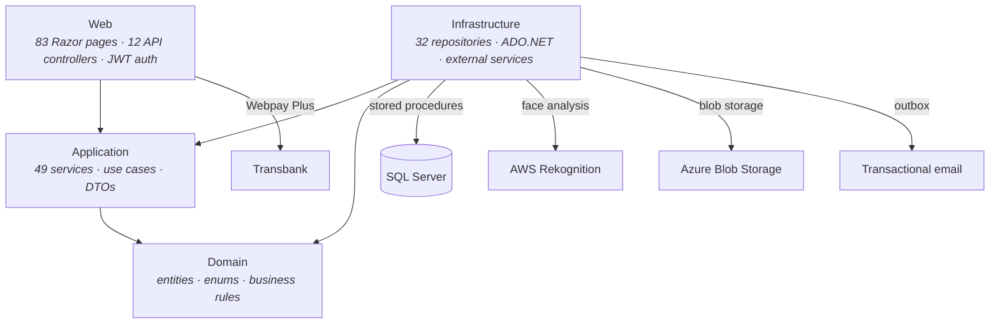
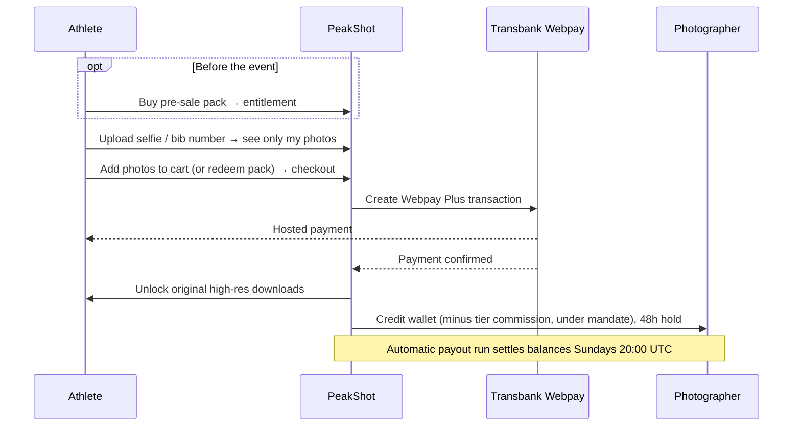

# PeakShot — Sports Photography Marketplace

> **Deployed at [peakshot.cl](https://www.peakshot.cl)** · The Chilean platform that lets athletes
> find their official event photos in seconds via facial recognition, and lets photographers
> automate selling, pre-selling and delivery. Built solo, end-to-end, on **.NET / Clean Architecture**
> with **SQL Server** (pure ADO.NET + stored procedures).

> **Status.** In production at peakshot.cl. Beyond the core marketplace (auth, public gallery,
> facial-recognition search, cart/checkout, photographer wallet & payouts, tier system, admin panel),
> the platform now ships **event pre-sales**, a **podium photo** product, a **mandate-based sales
> model** with buyer service fee and VAT handling, **Google sign-in**, **discount codes** and
> **abandoned-cart recovery**. CI enforces a **60% line-coverage minimum** over 2,208 test methods.

---

## The problem & the bet

Today a sports photographer spends **3–12 hours per event** filtering shots and sending them to
athletes one by one over WhatsApp or Drive. Athletes, in turn, scroll through thousands of unsorted
photos to find the handful they appear in.

**PeakShot removes both frictions.** Photographers upload everything unfiltered; the platform groups
photos by athlete automatically using **facial recognition + capture time**, then handles cart,
payment, and original-file delivery with **zero manual messages**. Athletes upload a selfie — or
search by bib number — and are shown only their own photos. With **pre-sales**, athletes can buy
their photo pack *before* the event, so the photographer gets paid demand up front.

The result the product sells: **3–12 hrs recovered per event · 0 manual DMs · 4 steps from camera to
payout.**

---

## At a glance

| Area | Detail |
|---|---|
| Architecture | Clean Architecture, 4 layers — Domain / Application / Infrastructure / Web |
| Data access | SQL Server with **pure ADO.NET + stored procedures** (no ORM) |
| Application services | **49** |
| Repositories | **32** |
| API controllers | **12** |
| Web pages | **83** (public, account, gallery, cart, orders, photographer, admin, legal) |
| Tests | **2,208 test methods across 263 files** · ≥60% line coverage enforced in CI |
| Photo matching | AWS Rekognition (face) + bib-number + keyword search · saved selfies with signed links |
| Payments | Transbank Webpay Plus |
| Monetization | Tiered commission, no fixed fee — 15% → 12% → 10%, Founder 8% · buyer service fee |
| Sales model | Mandate-based: PeakShot sells on the photographer's behalf, with commission regimes and VAT |
| Payouts | Wallet with 48h hold; automatic payout run Sundays 20:00 UTC |
| Storage | Azure Blob Storage (active), local fallback |
| Auth | Email/password, email sign-in codes, Google sign-in · JWT for APIs |

---

## Architecture

Strict dependency direction: outer layers depend inward, never the reverse. Domain depends on
nothing; Application orchestrates use cases; Infrastructure implements persistence and external
services; Web exposes pages and APIs.

The data-access layer deliberately uses **ADO.NET against stored procedures** rather than an ORM —
the same pattern I apply in enterprise work: explicit SQL contracts, execution plans under control,
and a clean Repository boundary between business logic and persistence. A dedicated
`StoredProcedureSignatureTests` suite guards the contract between C# repositories and SQL.

---

## Key modules

| Module | Responsibility | Key types |
|---|---|---|
| **Facial recognition** | Match an athlete's selfie to the photos they appear in; auto-group uploads by athlete | `AwsPhotoAnalysisService`, `PhotoFaceRepository`, `RekognitionWorker` |
| **Selfies** | Store an athlete's selfie and reuse it via signed links, with validation rules | `SelfieService`, `SelfieLinkSigner`, `SelfieRules` |
| **Photo search** | Search within an event by face, bib number, or keyword; rate-limited face search | `DbPhotoSearchService`, `PhotoSearchController` |
| **Catalog & portfolio** | Public event galleries, photographer profiles and portfolios, SEO-friendly slugs with redirects | `PortfolioService`, `PhotographerProfileService`, `SlugRedirectService` |
| **Cart & checkout** | Cart, orders, discount codes, abandoned-cart recovery, secure original downloads | `CartService`, `OrderService`, `DiscountCodeService`, `AbandonedCartService` |
| **Pre-sales** | Sell photo packs before the event: entitlements, redemption, folder release, delivery, refunds, balance transfers | `PresaleCheckoutService`, `PresaleEntitlementService`, `PresaleReleaseService`, `PresaleRefundService` |
| **Podium** | Dedicated podium-photo product: upload, public listing, order emails | `PodiumUploadService`, `PodiumPublicService`, `PodiumOrderEmails` |
| **Payments** | Transbank Webpay Plus hosted checkout | `PaymentsController`, `TransbankService` |
| **Mandate & commissions** | Mandate acceptance per event, commission regimes, buyer service fee, VAT on orders | `CommissionService`, `MandateAcceptanceRepository`, `MandateReportRepository` |
| **Photographer economics** | Wallet with 48h hold, sales, payout breakdowns, scheduled Sunday payouts | `WalletService`, `PayoutService`, `PayoutSchedulerService` |
| **Tier system** | Commission tiers that lower with volume; auto-recalc, history, manual assign | `AdminTierService`, `TierRecalculationJobService`, `TierHistoryRepository` |
| **Admin & operations** | Events, users, orders, commissions, payment center, payouts, Sunday operations, pre-sale liability & refunds, audit log, user impersonation | `AdminService`, `AuditService`, `ImpersonationService` |
| **Security** | Keyed attempt limiting, login enumeration protection, return-URL policy, in-app browser detection | `KeyedAttemptLimiter`, `AdminRateLimitService` |

---

## Key engineering decisions

### ADR 1 — Clean Architecture with pure ADO.NET + stored procedures (no EF)

- **Problem:** strict separation of concerns for long-term maintainability, plus full control over
  SQL for image-heavy, search-heavy queries.
- **Decision:** 4-layer Clean Architecture; Infrastructure repositories call stored procedures via
  ADO.NET — no ORM. Procedures are versioned through migration scripts.
- **Rationale:** explicit query control matters for gallery and search performance; stored procedures
  keep the data contract clear and testable; layering keeps domain logic free of infrastructure.
- **Trade-off:** more hand-written data-access code than an ORM — accepted for predictability and a
  clean dependency direction. Mitigated with signature tests that fail the build if a repository and
  its procedure drift apart.

### ADR 2 — AWS Rekognition behind a background worker

- **Problem:** the core differentiator — find-by-face and auto-grouping uploads by athlete — needs
  reliable face matching, and analyzing large photo batches can't block the upload request.
- **Decision:** integrate AWS Rekognition behind an `AwsPhotoAnalysisService` abstraction, driven by
  a background `RekognitionWorker`, with backlog handling; face data persisted via
  `PhotoFaceRepository`. Exposed through a rate-limited face-search endpoint.
- **Rationale:** a managed service shipped the differentiator fast; the background worker keeps
  uploads responsive while analysis runs asynchronously; the abstraction keeps the provider swappable.
- **Trade-off:** per-call cost and a cross-cloud dependency (the platform otherwise targets Azure),
  isolated behind an interface. Facial-recognition processing is governed under the platform privacy
  policy and Chilean personal-data law.

### ADR 3 — Tiered, usage-based commission as the monetization model

- **Problem:** photographers won't adopt a tool with a fixed monthly fee before it has proven it
  sells their photos; the platform needs aligned incentives and a growth loop.
- **Decision:** no subscription — a commission charged only on sales, **decreasing with volume**
  (15% default → 12% at 3 events → 10% at 20 events; a permanent 8% Founder tier for the first 20
  high-volume photographers). Tiers auto-recalculate, with full change history and manual override.
- **Rationale:** zero upfront risk drives adoption; the declining rate rewards retention and turns
  pricing itself into a reason to keep publishing here.
- **Trade-off:** revenue per sale starts lower and depends on volume — a deliberate bet on adoption
  and retention over short-term take rate.

### ADR 4 — Pre-sales as entitlements, not orders

- **Problem:** athletes want to secure their photos before race day, but at checkout time the photos
  don't exist yet — and some never will (no-shows, missed shots).
- **Decision:** a pre-sale purchase creates an **entitlement** (a pack balance) that is redeemed
  later against real photos, released per folder, with explicit refund and balance-transfer flows and
  an admin view of outstanding liability.
- **Rationale:** separating "money paid" from "photos delivered" makes every edge case (partial
  delivery, refunds, debt, transfers) an explicit state instead of a manual fix.
- **Trade-off:** a much larger domain surface (20+ services) — accepted because pre-paid demand is
  the strongest incentive for photographers to publish on PeakShot.

---

## Marketplace economics flow

---

## Quality & testing

| Layer | What's covered |
|---|---|
| Services | Cart, orders, pre-sales, commissions & mandate splits, wallet & VAT, payouts, tiers, selfies, discounts |
| Controllers | Cart, downloads, payments, photo search, selfies, slugs auth |
| Infrastructure | Stored-procedure signatures, Transbank, Rekognition backlog, watermarking, image processing, emails |
| Web | Markup & wiring tests for critical pages, SEO, auth flows (Google, JWT, impersonation), Chile time-zone rendering |

**2,208 test methods across 263 files**, with a **60% line-coverage gate enforced in CI** on `main`.

---

## Tech stack

| Area | Technology |
|---|---|
| Language / runtime | C# / .NET |
| Architecture | Clean Architecture (Domain · Application · Infrastructure · Web) |
| Data | SQL Server · ADO.NET · stored procedures (versioned migrations) |
| Frontend | Razor pages · JavaScript |
| Auth | Cookie sessions · JWT · Google sign-in · email sign-in codes |
| Cloud AI | AWS Rekognition (background worker) |
| Storage | Azure Blob Storage (active) · local fallback |
| Payments | Transbank Webpay Plus |
| Email | Outbox-based transactional email |
| Testing | 2,208 test methods · CI coverage gate ≥60% |
| Hosting | Production at peakshot.cl |

---

## Roadmap

- **Performance:** CDN for images, distributed cache for the public gallery, query optimization
- **Testing:** end-to-end (Playwright) coverage for checkout and pre-sale flows
- **Security:** dependency-vulnerability remediation and periodic review

---

## About

Designed and built end-to-end by a single developer as a real commercial venture under its own legal
entity. Full ownership of product, architecture, and implementation — domain modeling, stored
procedures, the Rekognition facial-recognition pipeline, Transbank payments, pre-sale entitlements,
the mandate-based commission model, and the tiered payout economy.
