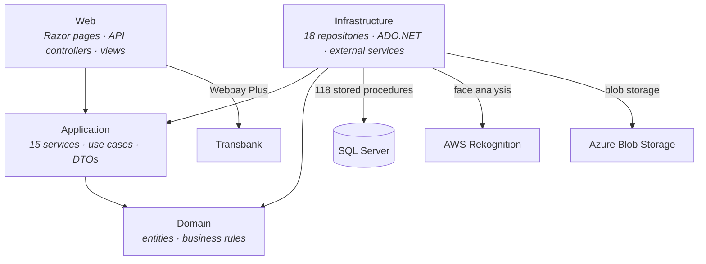
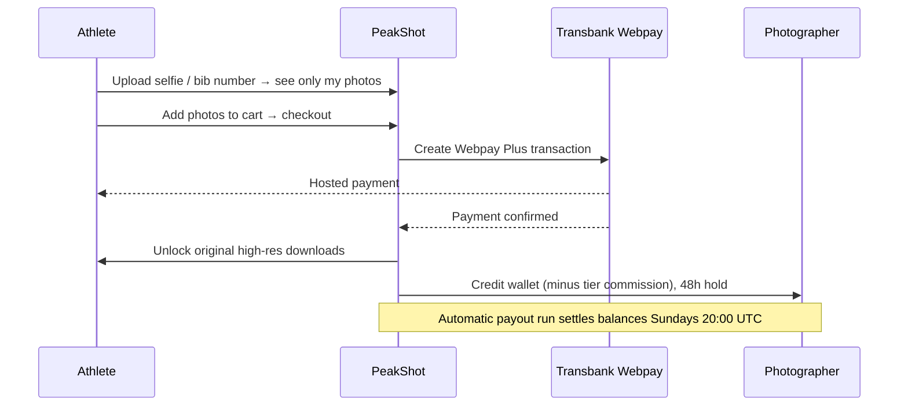

# PeakShot — Sports Photography Marketplace

> **Deployed at [peakshot.cl](https://www.peakshot.cl)** · The Chilean platform that lets athletes
> find their official event photos in seconds via facial recognition, and lets photographers
> automate selling and delivery. Built solo, end-to-end, on **.NET / Clean Architecture** with
> **SQL Server** (pure ADO.NET + stored procedures).

> **Status.** Deployed to production at peakshot.cl and functionally complete — authentication,
> public gallery, facial-recognition search, cart/checkout, photographer wallet & payouts, tier
> system, and a full admin panel are all in place. Payments run through Transbank Webpay Plus in
> integration (sandbox) mode pending go-live. Remaining pre-launch work is security and performance
> hardening (rate limiting, caching, CDN).

---

## The problem & the bet

Today a sports photographer spends **3–12 hours per event** filtering shots and sending them to
athletes one by one over WhatsApp or Drive. Athletes, in turn, scroll through thousands of unsorted
photos to find the handful they appear in.

**PeakShot removes both frictions.** Photographers upload everything unfiltered; the platform groups
photos by athlete automatically using **facial recognition + capture time**, then handles cart,
payment, and original-file delivery with **zero manual messages**. Athletes upload a selfie — or
search by bib number — and are shown only their own photos.

The result the product sells: **3–12 hrs recovered per event · 0 manual DMs · 4 steps from camera to
payout.**

---

## At a glance

| Area | Detail |
|---|---|
| Architecture | Clean Architecture, 4 layers — Domain / Application / Infrastructure / Web |
| Data access | SQL Server with **pure ADO.NET + stored procedures** (no ORM) |
| Stored procedures | **118**, across 33 migration scripts |
| Application services | 15 |
| Repositories | 18 |
| API controllers | 7 |
| Web pages | 47 |
| Tests | 165 test methods across 25 classes |
| Photo matching | AWS Rekognition (face) + bib-number + keyword search |
| Payments | Transbank Webpay Plus (integration mode pre-launch) |
| Monetization | Tiered commission, no fixed fee — 15% → 12% → 10%, Founder 8% |
| Payouts | Wallet with 48h hold; automatic payout run Sundays 20:00 UTC |
| Storage | Azure Blob Storage (active), local fallback |

---

## Architecture

Strict dependency direction: outer layers depend inward, never the reverse. Domain depends on
nothing; Application orchestrates use cases; Infrastructure implements persistence and external
services; Web exposes pages and APIs.

The data-access layer deliberately uses **ADO.NET against stored procedures** rather than an ORM —
the same deliberate pattern I apply in enterprise work: explicit SQL contracts, execution plans
under control, and a clean Repository boundary between business logic and persistence. 118 stored
procedures are versioned across 33 migration scripts.

---

## Key modules

| Module | Responsibility | Key types |
|---|---|---|
| **Facial recognition** | Match an athlete's selfie to the photos they appear in; auto-group uploads by athlete | `AwsPhotoAnalysisService`, `PhotoFaceRepository`, `RekognitionWorker` |
| **Photo search** | Search within an event by face, bib number, or keyword | `DbPhotoSearchService`, `PhotoSearchController` |
| **Catalog & portfolio** | Public event galleries, photographer public portfolio pages | `PortfolioService`, `PortfolioController` |
| **Cart & checkout** | Cart, orders, secure delivery of original high-res downloads | `CartController`, `DownloadsController` |
| **Payments** | Transbank Webpay Plus hosted checkout | `PaymentsController` |
| **Photographer economics** | Wallet with 48h earnings hold, sales, scheduled Sunday payouts | `WalletService`, `PayoutService`, `PayoutRunRepository` |
| **Tier system** | Commission tiers that lower with volume; auto-recalc, history, manual assign | `AdminTierService`, `TierRecalculationJobService`, `TierHistoryRepository` |
| **Admin** | Events, users, orders, commissions, payment center, payouts, Sunday operations, tiers | Admin dashboard suite |

---

## Key engineering decisions

### ADR 1 — Clean Architecture with pure ADO.NET + stored procedures (no EF)

- **Problem:** strict separation of concerns for long-term maintainability, plus full control over
  SQL for image-heavy, search-heavy queries.
- **Decision:** 4-layer Clean Architecture; Infrastructure repositories call stored procedures via
  ADO.NET — no ORM. 118 procedures versioned across 33 migration scripts.
- **Rationale:** explicit query control matters for gallery and search performance; stored procedures
  keep the data contract clear and testable; layering keeps domain logic free of infrastructure.
- **Trade-off:** more hand-written data-access code than an ORM — accepted for predictability and a
  clean dependency direction.

### ADR 2 — AWS Rekognition behind a background worker

- **Problem:** the core differentiator — find-by-face and auto-grouping uploads by athlete — needs
  reliable face matching, and analyzing large photo batches can't block the upload request.
- **Decision:** integrate AWS Rekognition behind an `AwsPhotoAnalysisService` abstraction, driven by
  a background `RekognitionWorker`; face data persisted via `PhotoFaceRepository` with 6 dedicated
  stored procedures. Exposed through `POST /api/search/face/{eventId}` with conditional UI in the
  event gallery.
- **Rationale:** a managed service shipped the differentiator fast; the background worker keeps
  uploads responsive while analysis runs asynchronously; the abstraction keeps the provider swappable.
- **Trade-off:** per-call cost and a cross-cloud dependency (the platform otherwise targets Azure),
  isolated behind an interface. Facial-recognition processing is governed under the platform privacy
  policy and Chilean personal-data law.

### ADR 3 — Tiered, usage-based commission as the monetization model

- **Problem:** photographers won't adopt a tool with a fixed monthly fee before it has proven it
  sells their photos; the platform needs aligned incentives and a growth loop.
- **Decision:** no subscription — a commission charged only on sales, **decreasing with volume**
  (15% default → 12% at 3 events → 10% at 20 events; a permanent 8% Founder tier for the first 20
  high-volume photographers). Tiers auto-recalculate, with full change history and manual override.
- **Rationale:** zero upfront risk drives adoption; the declining rate rewards retention and turns
  pricing itself into a reason to keep publishing here.
- **Trade-off:** revenue per sale starts lower and depends on volume — a deliberate bet on adoption
  and retention over short-term take rate.

---

## Marketplace economics flow

---

## Tech stack

| Area | Technology |
|---|---|
| Language / runtime | C# / .NET |
| Architecture | Clean Architecture (Domain · Application · Infrastructure · Web) |
| Data | SQL Server · ADO.NET · 118 stored procedures (33 migrations) |
| Frontend | Razor pages · JavaScript |
| Cloud AI | AWS Rekognition (background worker) |
| Storage | Azure Blob Storage (active) · local fallback |
| Payments | Transbank Webpay Plus |
| Testing | 165 test methods across 25 classes |
| Hosting | Production at peakshot.cl |

---

## Remaining before public launch

- **Payments:** promote Transbank from integration (sandbox) mode to production
- **Security:** rate limiting on login/uploads, dependency-vulnerability remediation
- **Performance:** Redis cache for the public gallery, image lazy-loading, query optimization, CDN
- **Testing:** integration / E2E (Playwright) coverage for critical flows

---

## About

Designed and built end-to-end by a single developer as a real commercial venture under its own legal
entity. Full ownership of product, architecture, and implementation — domain modeling, 118 stored
procedures, the Rekognition facial-recognition pipeline, Transbank payments, marketplace mechanics,
and the tiered payout economy.
